# Under the Green: encounter design

November 11, 2026. Proposed design, not implemented or playtested. Develops the user's approved direction: Joe walks slowly with a hedge trimmer while the player times water obstacles. This document governs Under the Green details where the broader campaign proposal differs. All durations and balance numbers are prototype hypotheses.

## What should feel good

The player is faster than Joe, but cannot always move forward. Success is recognizing a water window, choosing an escape route and using the next discharge to separate themselves from him. The reward is visible: Joe reaches the bank too late and must stop while the player gets away.

The repeated sequence is: read the water and Joe -> choose a route -> commit to crossing -> see the distance earned -> orient toward the next landmark. Keep this readable without a numeric distance meter or a permanent countdown.

Three recurring choices support the chapter:

- **Timing:** take the current opening or reach a dry detour before Joe closes in.
- **Position:** use a longer dry route to keep moving, or a wet shortcut to build a larger lead.
- **Intervention:** operate the pump-house bypass to change a difficult crossing into a barrier behind you.

Timing teaches competence; route choices prevent repetition; the bypass gives the chapter a moment where the player takes control. Hiding and ball distractions remain useful, but required progress must work with no balls and no optional evidence.

Implementation refinement, November 12: a closing bank window may explicitly offer running when ordinary walking cannot clear it. The option uses the existing movement profile and the same timing/clearance reserve as normal advice, names the actual hold/toggle control, and retains waiting or a dry route as alternatives. It disappears during incompatible stances, recovery, active running or danger. Do not silently assume sprinting behind a walking CROSS prompt. See `qa/under-green-running-option-2026-11-12.md` for boundary, continuous-route and device-input evidence; first-time comprehension remains unvalidated.

## Level shape and pacing

Build five substantial water decisions, including the protected tutorial, across a 6-9-minute first clear. Do not make every corridor a test. Use short connective stretches for anticipation, orientation and the player's own pace. Extend only when a new space introduces a new decision.

```mermaid
flowchart LR
  A[Grate refuge] --> B[Root gallery: learn the water]
  B --> C[Joe descends with the trimmer]
  C --> D[Spillway: short crossing or dry loop]
  D --> E[Bunker undercroft: earn a water barrier]
  E --> F[Pump house: redirect the flow]
  F --> G[Range trench: alternate outlets]
  G --> H[Keeper's room: close the sluice]
  H --> I[Safe access to the 18th]
```

Each space has one recognizable destination, one main water mechanism and at most one alternate route. The course above explains the architecture: roots under rough, sand below a bunker, drain screens below the practice range and irrigation headers near the 18th. Brief surface views prevent visual fatigue.

The intended intensity rises from safety to the first pressured crossing, falls behind an earned water barrier, rises at the pump house, pauses briefly after the bypass and peaks in the final trench. The chapter ends with uninterrupted relief. Joe does not need to be close at every moment for the level to work.

## Encounter 1: the roots below the green

**Purpose:** establish the water rule and let the player succeed before introducing pursuit.

The entry grate closes out the mower. A dry walkway overlooks a small transverse spillway and the destination landing. Roots penetrate concrete joints; lost golf balls roll a short distance when discharge begins. A maintenance gauge is visible from the player's waiting position.

The outlet runs, pipes knock before the next pressure change, water visibly drops and the player crosses. Nobody can attack during this first lesson. A missed crossing produces the same recoverable shove used later, but no threat penalty. The dry landing faces the next exit, avoiding an immediate turn into an unseen hazard.

Do not require the player to endure a full cycle to satisfy a tutorial flag if they arrive during a safe opening. Make the cycle legible as they approach, and let observant players simply cross.

**Exit image:** a hatch opens ahead on a connected upper maintenance gallery. Joe descends carrying a long hedge trimmer. He makes one failed pull on its starter, then gets it running. Its tooth bar vibrates under the lamp. The player can move throughout; he begins at a generous physical distance rather than blocking the only exit.

## Encounter 2: the first spillway

**Purpose:** combine a known water cycle with a slow approaching threat.

The direct route crosses a short discharge channel. A dry retaining-wall loop departs before the bank and rejoins the far landing. Both endpoints are visible from the choice point. Use footprints, a handrail and continuous masonry to make the detour look traversable without a floating waypoint at every turn.

The player can glance back from the bank and still see the gauge in peripheral view. Joe advances along the approach they just used. His silhouette and trimmer sound communicate distance; optional captions identify approach direction.

- Arriving early in a low-flow window favors the direct crossing.
- Arriving during discharge with Joe distant permits waiting.
- Arriving during discharge with Joe close favors the dry loop.
- Crossing just before the pressure rises produces the first major reward: water separates the actors, and Joe stops on the opposite bank.

The loop must not return the player directly into Joe or require running past his attack range. Its clearance is proven with both actors present. Joe chooses a feasible route using what he has observed; he does not anticipate a hidden choice.

**Recovery:** a short wall beyond the landing blocks sight. A player who has earned a lead may stop here. Joe remains physically where the crossing left him, with no catch-up relocation.

## Encounter 3: beneath the bunker

**Purpose:** make the timing reward satisfying, then vary the spatial problem.

An open-topped drainage cut passes beneath a bunker retaining wall. Sand stains the concrete. The flag and bunker lip are visible above. Here the water fills a shallow crossing rather than spraying across it; the same gauge, pipe sounds and low-flow rule apply.

The route bends back alongside its approach. After crossing, the player can see Joe over the intervening channel. He is close in straight-line distance but has a long actual route to reach them. This creates a strong threatening image without cheating collision or attack reach.

One service stair provides an optional Joe flank. Its connection is visible from the waiting position, and his footsteps travel along it. He chooses it only when it is feasible and supported by observed evidence or his ordinary search route. It cannot activate by spawning him ahead or reading hidden player position. If its spatial logic is unclear in the prototype, omit the flank.

Offer one small evidence recess after the crossing, with its return route visible. The record can be collected quickly and read later from safety. It explains poor drainage and heavy-machine access restrictions, foreshadowing the finale without providing required knowledge.

**Recovery:** a reinforced inspection grille protects a small optional refuge. Joe can remain visible outside while the player reads, but eventually searches onward after losing evidence. Do not punish the use of a designated refuge with an unannounced break-in.

## Encounter 4: the pump-house reversal

**Purpose:** let the player change the situation instead of only responding to it.

The onward channel is under sustained discharge. From a safe observation landing, the player sees a plainly connected bypass pipe feeding an unused channel behind the route. A single lever redirects the flow. The mechanism provides its own readable explanation through the pipes, moving valve and resulting water paths; no circuit puzzle or multiple key hunt.

Reaching the lever requires passing the open pump-room approach. The lever itself sits behind a solid buttress with enough maneuvering room to disengage. Interact operates it once; do not use a prolonged, stationary crank as manufactured suspense.

The accepted action starts a visible mechanical sequence: linkage moves, the onward water level falls, then the rear spillway activates after its normal warning. It cannot damage an actor standing in a supposedly safe landing. The player sees the new route and can move as soon as it becomes usable.

This change buys time because Joe has to wait or use a longer connected service access. He can reach the lever later, but does not reset the player's completed progress. A locked maintenance latch and the visible linkage establish why the bypass remains in place.

**Player payoff:** the pump sound falls away, the trimmer becomes distinct on the far side, and for once Joe is the one waiting. No taunting HUD badge is needed.

**Checkpoint:** save after the player reaches the protected far landing. The live run preserves the actual separation earned. A retry restores a tested encounter-entry state with the bypass completed, a valid water phase and Joe on a legitimate approach. It must not reproduce an unwinnable last-second autosave.

## Encounter 5: the range trench and closing sluice

**Purpose:** combine learned choices into a short climax, with a clear physical finish.

Two alternating outlets cross a maintenance trench beneath the abandoned range. A broad central island divides it into two independent crossings. From the first bank, the player can see the island, keeper's room and final barrier. Range balls intermittently clatter against a downstream screen, reinforcing the setting and water direction.

The first crossing resembles the tutorial. At the island the player must reassess the second outlet instead of assuming both cycles match. A persistent dry perimeter route is the longer fallback. Introduce the alternating relationship from a protected view before the player commits; do not change it mid-crossing to force a near miss.

November 12 implementation candidate: the twelve-second cycle uses A/B/keeper offsets 7/4/3.25. B opens three seconds after A and the keeper opens 0.75 seconds after B, preserving existing safe durations. Continuous route comparisons now show meaningful walking and cautious wet-route gains; the earlier schedule erased those gains downstream. Acceptance remains open for an occupied-keeper recovery, a fixed all-crouch arrival and sprint-route tradeoffs. See `qa/under-green-range-cadence-2026-11-12.md`; these timings are measured tuning, not human experience validation.

Joe keeps walking. An expert can cross both windows efficiently and reach the door well ahead. A cautious player can pause at the island or use the perimeter. A water mistake may require a changed route but must leave a recovery option if Joe has not already been allowed into attack range through repeated errors.

The player reaches a dry threshold and operates the sluice release using the familiar Use control. Gate motion begins immediately and collision follows its actual geometry. A final water discharge holds Joe at the far bank long enough for the demonstrated closure action; tune the approach geometry and phase relationship to make this achievable without a perfect input.

Test boundary cases explicitly: Joe already near the threshold, player abandoning the closure, pause/reload during motion, repeated input and both actors at the gate. No blade hits through metal, victory through an open gap or camera-driven immunity before the barrier is secure. If the player arrives too late and is attacked before closure succeeds, retry only this final encounter.

Once the sluice is physically secured, success is permanent. Joe arrives at the opposite side with the trimmer. He lowers it and watches. Give the player control to walk away while the machinery fades; faint artificial applause draws them toward the championship grounds. No last surprise attack after completion.

## Water behavior and recovery

Use one consistent phase sequence: low flow -> pressure warning -> discharge -> recession -> low flow. Mechanical motion, gauge position and optional captions express actual phase. A first prototype may use a 12-second total cycle with approximately 6 seconds of traversable low flow and a typical 3-second crossing. These are not final balance values.

Validate the remaining traversable time, not merely whether the water currently looks low. Increasing turbulence and a moving gauge should warn a player approaching late in a window. Do not switch from visibly safe to dangerous in a single frame.

Crossings use normal movement. No jumping precision, balance minigame, forced camera turn or slippery steering. Dry land has crisp stopping behavior. Water resistance is stable and visually understandable; it does not unpredictably rotate the player.

On a surge hit, apply one short controlled shove along the visible flow into an authored catch landing. Geometry must ensure that landing is reachable by continuous movement, clear of obstruction and outside an active enemy strike. Never teleport across the channel to repair a badly designed landing. If safe displacement cannot be ensured, stop the player against a visible railing instead and let the pulse subside. Briefly protect recovery from a chained hit while input returns; represent this as the railing/landing stopping the fall, not repeated invisible rescues.

Recovery steering must change the landing lane. The current acts longitudinally toward the entry bank; it must not pull the player back to a fixed horizontal coordinate after accepting a sidestep. Allow the player to reverse lateral direction and retreat during displacement, while walls, Joe and active forward flow remain physical constraints. Do not rotate the camera or change the normal on-foot movement profile. The November 12 recovery-control pass verifies both-bank approaches, steering reversals and actual browser input adapters; human comfort and cue recognition remain separate acceptance requirements. See `qa/under-green-recovery-control-2026-11-12.md`.

Limit the penalty to one hit per discharge entry. A caught player must regain control before the next decision. Joe observes the same solid boundaries and water danger. Water can halt or displace him too, with readable recovery; it does not defeat him permanently or remove his threat for the entire chapter.

The pressure window is a layout problem as much as a timer. At a mandatory waiting position, compare Joe's actual remaining path to attack reach against the remaining water wait, crossing time and a reaction reserve. A safe-looking mandatory route fails design review if these quantities guarantee capture. Test arrivals at every phase, not only a conveniently timed demonstration.

One missed ordinary window should allow a detour or recovery in the intended approach envelope. Repeatedly ignoring warnings can allow Joe to catch the player. Do not promise limitless mistakes or secretly slow him whenever the player is losing.

## Joe: presence, perception and attack

Use a deliberate walk, initially around 60-70% of the player's normal dry-ground speed, with no sprint or distance-based rubber-banding. Keep turns, stair movement and stopping grounded. His trimmer hand pose and blade orientation must match its real reach.

The petrol trimmer distinguishes him from both mower chapters: small motor idle, sharp reciprocating blade rattle, rev before contact and little metallic vibration when he stops. Keep footsteps legible enough to locate him during quiet sections. The trimmer never becomes an unexplained ranged weapon.

Behavior states: enter -> walk toward observed evidence -> inspect/search -> walk toward new evidence -> prepare attack -> committed sweep -> recover. Water wait and a visible connected detour interrupt locomotion. Joe follows evidence, not the player's hidden coordinates. Loss of sight can genuinely buy time.

A close attack uses an initial prototype of roughly 0.9 seconds of readable preparation, a short committed sweep and about 1.2 seconds of recovery. Adjust using actual retreat distances, camera visibility and touch response. The numbers alone do not establish fairness. Joe plants and revs, the blade commits to its visible arc, and a successful dodge cannot be canceled by retargeting during that arc.

An active blade hit defeats the player. Ordinary proximity, the idle weapon pose, hearing a splash or touching Joe's broad navigation capsule does not automatically kill. Body collision still prevents walking through him. Blade collision sweeps through its real motion and respects concrete, closed grilles and mechanism geometry.

Approaches must give room to avoid a first attack. Do not place a necessary lever in a dead-end pocket where activating it guarantees being cornered. If Joe misses and clips designated roots, show clipped vegetation and a brief tool recovery. This is a readable consequence of that attack, not a universal stun against every wall.

Failure cuts from a brief impact to a clear defeat reason and immediate retry. Keep coaching practical: for example, "The discharge delayed you. The dry walkway stays open." Avoid presenting a guessed cause when the actual cause was an attack from a different route.

## Drama, art and sound

Make the course above present throughout: sprinkler ticks through ceilings, root mats, trapped golf balls, washed bunker sand, sector numbers and glimpses of flags. Use warm maintenance lamps against cold water reflections. Emergency lamps remain steady; water motion and the trimmer carry energy without constant flashing.

Compose the first pressured bank so Joe and the water gauge can be read in one glance or a small voluntary turn. Later encounters may require a quick rear glance, but the pressure cue remains audible and optionally captioned. Do not require a full camera turn every second to maintain basic awareness.

Reserve the strongest authored moments for the hatch descent, Joe waiting across a player-earned water barrier, the bypass reversal and the secured final sluice. Do not add unrelated ghost flashes or repeated fake-outs during these interactions.

Use very little dialogue. Candidate lines, to be tested in context: at first appearance, "This is still my course." When the bypass cuts him off, a quiet "Fine." At the final barrier, no line may be stronger than his engine falling to idle. Do not bury hazard cues under comedy.

When discharge masks the trimmer acoustically, retain other fair ways to estimate danger: a visible approach, known route, optional threat caption or a clear chance to look back. Reduced motion and zero-flash settings preserve the exact timing information. Static geometry must remain readable through spray at compact touch resolutions.

## Replays, difficulty and reward

First clear rewards survival and relief. A clean crossing naturally rewards speed and separation, without stacking achievement popups during danger. Optional evidence appears in the journal and chapter result. No completion requirement depends on reading during pursuit.

Keep the authored water phases and route logic learnable on replay. Do not randomize a previously safe opening to manufacture surprise. Player arrival time and Joe's actual evidence state already create variation.

Use existing difficulty preferences consistently. A more forgiving setting can give Joe a slower walk within the always-slower-than-player range and a longer attack warning. Keep water cues truthful and the available paths identical. Harder pressure must not remove recovery routes, add silent attacks or raise his speed into a run.

Players who master the chapter may create a large lead. Let that success stand. If repeated play reveals that the second half has no decisions, adjust baseline layout and cadence in development, not through hidden in-run catch-up.

## Prototype and acceptance plan

Build Encounter 2 first with primitive geometry, one water outlet, the dry loop and a placeholder walking Joe with real attack collision. Include water mistakes and both actors in the same simulation from the start. A cinematic or finished trimmer model is not required to judge the interaction.

Playtest these hypotheses before building the whole level:

| Hypothesis | Observe | Revise if |
| --- | --- | --- |
| Water timing is understandable | Unprompted explanation after the protected crossing | Players think the loud discharge is the cue to enter |
| Both routes support real decisions | Choices at several water phases and Joe distances | One route is always faster, safer and easier |
| Good timing feels rewarding | Player reaction when water separates them from Joe | The earned lead disappears or Joe crosses anyway |
| Waiting is suspenseful rather than tedious | Time spent idle and reasons given afterward | Players mostly stare at a gauge with nothing meaningful to assess |
| Water mistakes are recoverable | First missed crossing and resumed movement | Chained stuns, unavoidable attacks or confusing displacement |
| Slow Joe remains threatening | Full attempts including skilled play | Only a speed boost or teleport can maintain the encounter |
| Attacks are fair | First close encounters on mouse, controller and touch | Hits precede an understandable warning or pass through cover |
| The chapter has rhythm | Uninterrupted first clears | Every room is the same wait-cross loop, or relief never arrives |
| The finale earns completion | Ordinary and late arrivals at the sluice | A perfect input is required, or victory fires before physical safety |

Use a small initial mix of unfamiliar and experienced players, including touch/controller players. Ask for descriptions before explaining the rules. Record idle time, water hits, chosen routes, attack warnings/hits, separation at landings and checkpoint losses. These observations guide revisions; they are not proof of universal fun or accessibility.

Automated verification should cover complete water phase boundaries, collision sweeps, both actors' water response, no-hit-through-cover, dry-route reachability, zero-ball completion, pause, save/restore and final closure. Enumerate arrival phases and plausible approach distances to detect impossible waits. Human playtests decide whether anticipation, relief, choices and drama actually work.

After the first encounter succeeds, build the pump-house reversal and the final alternating outlets. Add the bunker space only if it adds a different decision or a valuable breather. Finish art, sound and performance work after the playable routes and timings are stable.

## Campaign consequence

This chapter already gives players a sustained encounter with Joe on foot. A second prolonged on-foot chase after the finale's enormous rig would repeat the experience and weaken the campaign ending. Prefer a brief visible dismount behind an already-secured boundary after the rig is defeated. The Final Cut should end on the player's victory and the ruined golf course.

This proposal adds design detail only. No level, enemy, water system, art, audio or performance outcome is claimed as implemented or validated.
